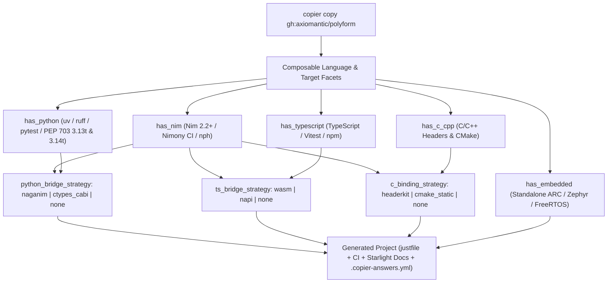

import { Card, CardGrid } from '@astrojs/starlight/components';

## Quick Start

Scaffold a new polyglot repository with [Copier](https://copier.readthedocs.io/):

```bash
# Zero-install invocation via uvx
uvx copier copy --trust gh:axiomantic/polyform my-project

cd my-project
just setup
just test
```

## Architecture & Composable Facet Matrix

Polyform generates tailored, closed-circuit repositories from a composable matrix of language toolchains and bridge strategies:



## Core Capabilities

<CardGrid stagger>
  <Card title="Composable Multi-Language Facets" icon="puzzle">
    Combine Nim (`has_nim`), Python (`has_python`), TypeScript (`has_typescript`), C/C++ (`has_c_cpp`), and freestanding Embedded (`has_embedded`) facets in any valid topology.
  </Card>
  <Card title="First-Class Native Bridges" icon="rocket">
    Pre-wired bridges for Python (`naganim` CPython `abi3`/`abi3t` + CFFI or `ctypes_cabi`), TypeScript (`wasm` Emscripten/standalone or `napi`), and C/C++ (`headerkit` declarative FFI).
  </Card>
  <Card title="Non-Destructive Template Upgrades" icon="seti:git">
    Downstream repositories track `.copier-answers.yml` so `uvx copier update --trust` cleanly merges upstream CI, toolchain, and template improvements.
  </Card>
  <Card title="Hardened CI & Release Pipelines" icon="seti:pipeline">
    Includes Nimony (Nim 3.0 preview) checks, PEP 703 Free-Threaded Python (`3.13t`/`3.14t`) `cibuildwheel` matrices, Renovate/Dependabot configs, and Astro Starlight API docs.
  </Card>
</CardGrid>
